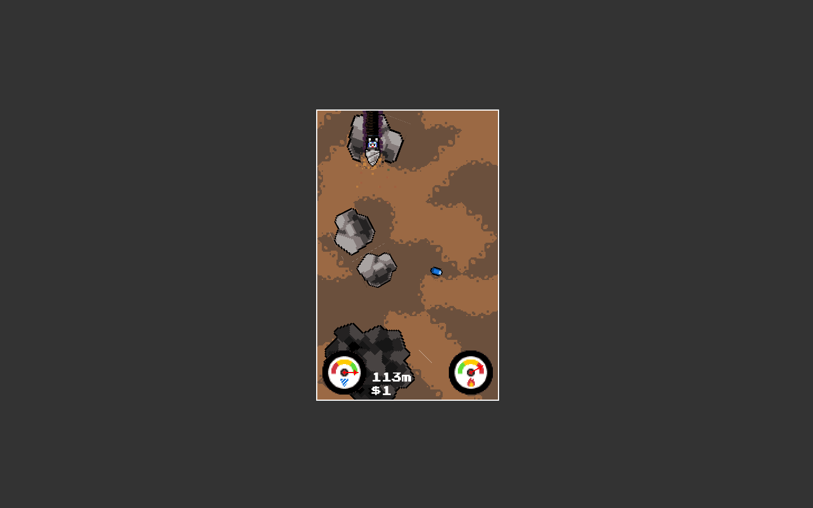
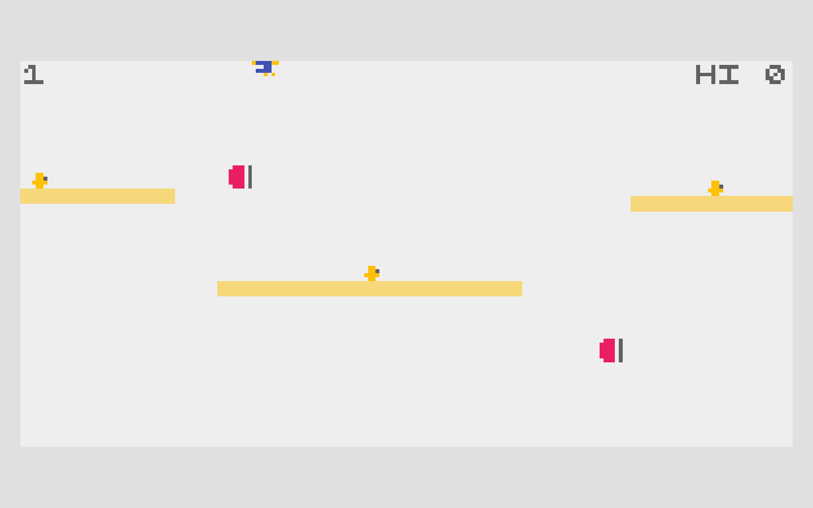

# Burrow Haul — design references

Published documentation by Arcane Forge. Updated: 2026-10-21, Asia/Shanghai.

Drill down with a train of valuable pods. Your tail remembers every bend—and one pod can buy a brief escape from danger.

## Drill Bunny

Dream Show Adventures · Steve Richey / Andrew Agulto.

[Original primary source](https://github.com/DreamShowAdventures/LudumDare29)

Borrowed mechanism: Automatic descent, lateral route choices, and cooling in open terrain.

## IN TOW

ABA Games / Kenta Cho.

[Original primary source](https://github.com/abagames/crisp-game-lib-games/blob/cfb39d2f988feb5918eb83697145b5a35adabf58/docs/intow/main.js)

Borrowed mechanism: Followers trace your path, increase value, and can be spent for survival.

## What changed

| Reference operation | New game operation |
| --- | --- |
| Regenerating boost reserve | Spend actual carried cargo to cool/protect |
| Followers fund a jump | Delayed pods must survive drilled bends |
| Endless depth / pickup score | Three banking lifts and a delivery quota |

These works are design references. Reference captures illustrate the compared mechanics; no reference game code, sprites or audio are included in the playable build. The Unity implementation and operational game art are original. Source-code licenses are not a claim of permission to reuse unrelated assets.

[Back to the visual pitch](burrow-haul.html) · [All five pitches](index.html)
