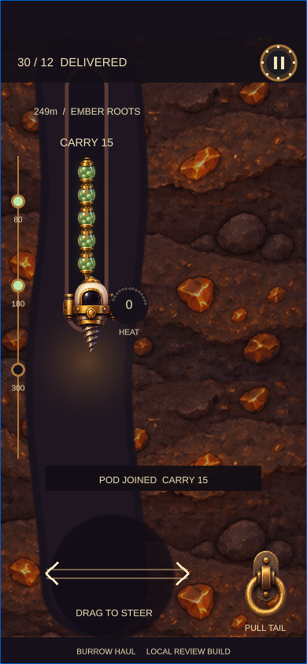
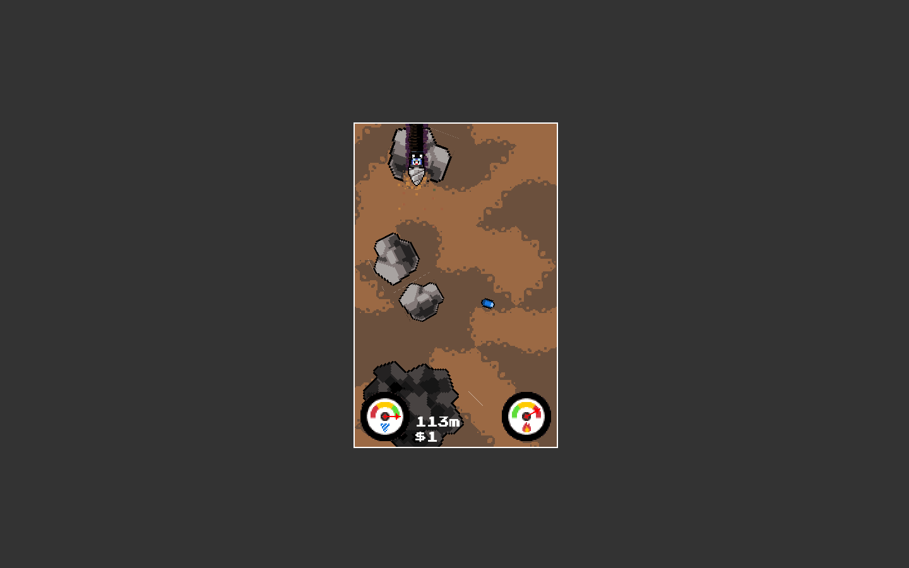
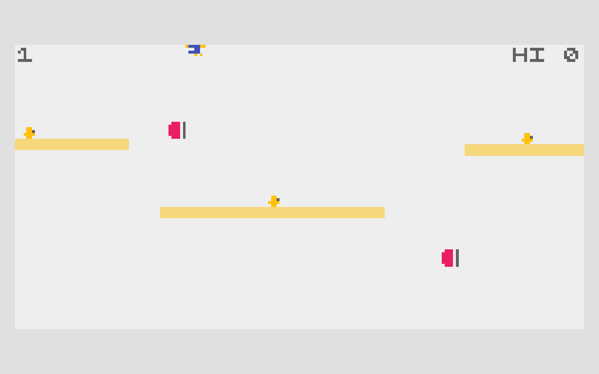

# Burrow Haul — visual pitch

Author: Codex manager. Authority: user-requested presentation of the delegated working design. Human review: pending. Updated: 2026-10-20, Asia/Shanghai.

## Your fortune follows you.

Drill down with a train of valuable pods. Your tail remembers every bend—and one pod can buy a brief escape from danger.

## References and borrowed parts

### Drill Bunny

Dream Show Adventures · Steve Richey / Andrew Agulto. Borrowed: Automatic descent, lateral route choices, and cooling in open terrain.

### IN TOW

ABA Games / Kenta Cho. Borrowed: Followers trace your path, increase value, and can be spent for survival.

[Full source claims and provenance](burrow-haul-references.html)

## Mutation

| Before | Our change |
| --- | --- |
| Regenerating boost reserve | Spend actual carried cargo to cool/protect |
| Followers fund a jump | Delayed pods must survive drilled bends |
| Endless depth / pickup score | Three banking lifts and a delivery quota |

**New decision:** Keep the valuable long train, or shed its tail to survive the hot crossing?

Example: four pods and heat 80. A release cools 35 and protects the remaining train for 0.9 seconds.

### Keep four pods

More to bank. More tail to protect. Preserve the full haul and thread a cooling route. A snag can cut off the trailing pods.

Pods: 4; Carried value: 10; Heat: 80 / 100.

### Release the tail

Spend value to keep the run alive. Lose the last pod immediately. Take the protected crossing with a shorter train.

Pods: 3; Carried value: 6; Heat: 45 / 100.

[Interactive rule diagram](burrow-haul.html#mutation)

## Game design

Collect: Attach visible pods → Route: Keep the tail off the rocks → Commit: Cool naturally or spend a pod → Bank: Unload at 80 / 180 / 300 m.

Control: Drag to steer; pull the tail. Win: Bank 12+ value by 300 m. Pressure: Heat + a vulnerable cargo train.

## Why it could be fun

- **Greed you can see.** Four pods bank 10; five bank 15. The growing tail is the prize.
- **A route with consequences.** Your nose clears a corner before the lagging cargo does.
- **Relief after tension.** Each lift turns a fragile haul into secured value.

These are design hypotheses, not validated enjoyment claims.

**Playtest question:** Does sacrificing a pod feel like a useful choice rather than a forced tax?

[Open pitch](burrow-haul.html) · [Play game](https://games.arcaneforge.ai/game-library/burrow-haul/index.html) · [GDD](burrow-haul.html#design) · [All five](index.html)

Existing original Unity code/art. Source captures are local documentation evidence, not runtime assets. TikTok Minis is the intended destination; native packaging/device validation and human review remain pending. Audio is currently silent.
