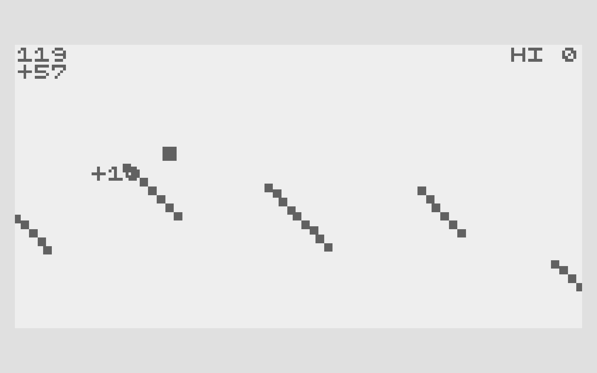
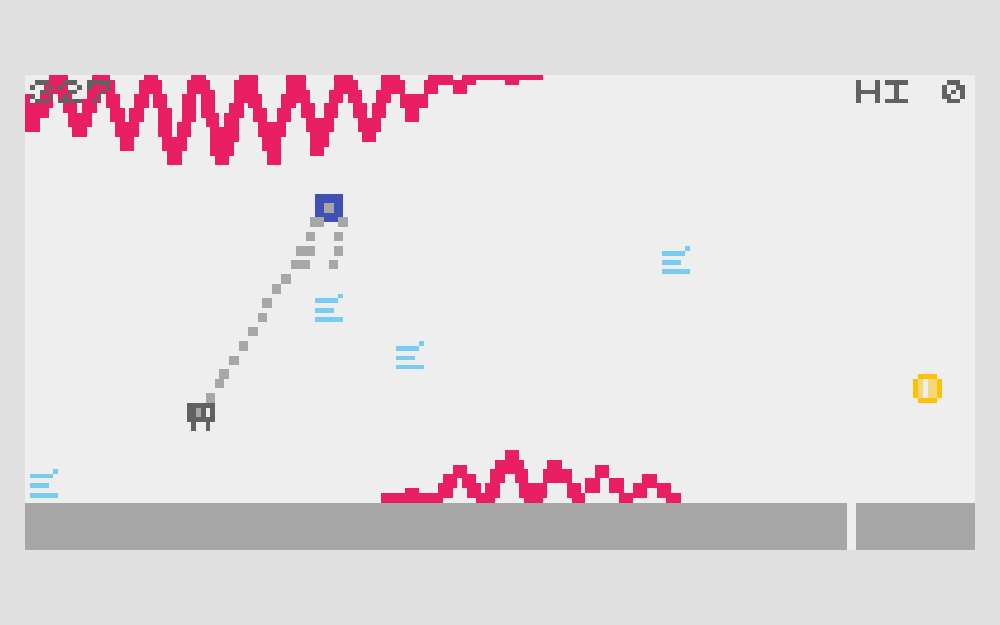

# Cloudhook Courier — design references

Published documentation by Arcane Forge. Updated: 2026-10-21, Asia/Shanghai.

Sling a tiny courier between floating islands. Fold the kite to land and bank your seals, or keep sailing for a more valuable chain.

## CATAPULT

ABA Games / Kenta Cho.

[Original primary source](https://github.com/abagames/crisp-game-lib-games/blob/cfb39d2f988feb5918eb83697145b5a35adabf58/docs/catapult/main.js)

Borrowed mechanism: Skipping supports grows at-risk flight value; landing banks it.

## KITE

ABA Games / Kenta Cho.

[Original primary source](https://github.com/abagames/crisp-game-lib-games/blob/cfb39d2f988feb5918eb83697145b5a35adabf58/docs/kite/main.js)

Borrowed mechanism: A tether separates the lifted sail from the vulnerable hanging actor.

## What changed

| Reference operation | New game operation |
| --- | --- |
| Rolling launch / global tilt | Direct sling aim + hold-to-sail flight |
| Separate launch and tether ideas | The courier must physically catch the bank hook |
| Endless scoring | Finite postal route; seals add optional reward |

These works are design references. Reference captures illustrate the compared mechanics; no reference game code, sprites or audio are included in the playable build. The Unity implementation and operational game art are original. Source-code licenses are not a claim of permission to reuse unrelated assets.

[Back to the visual pitch](cloudhook-courier.html) · [All five pitches](index.html)
