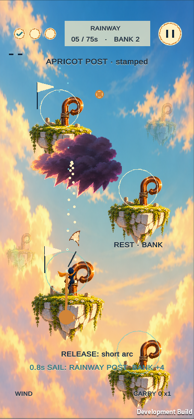
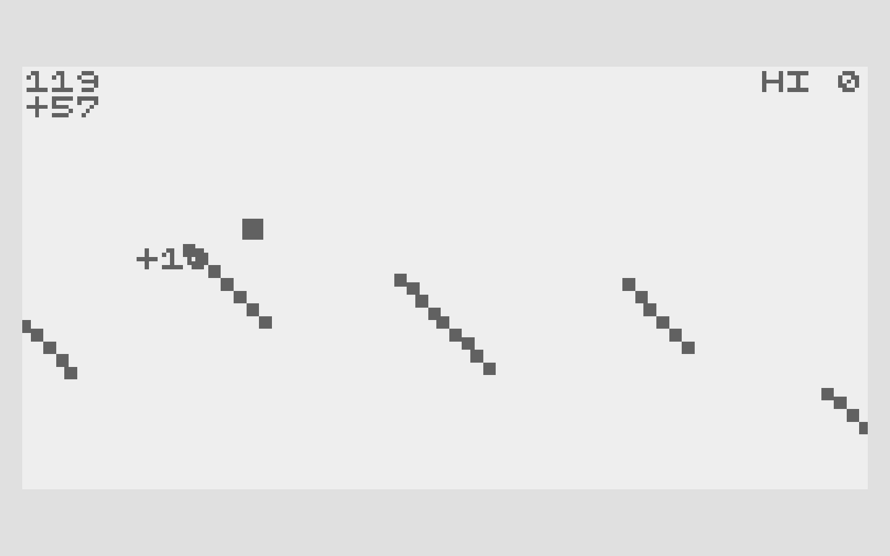
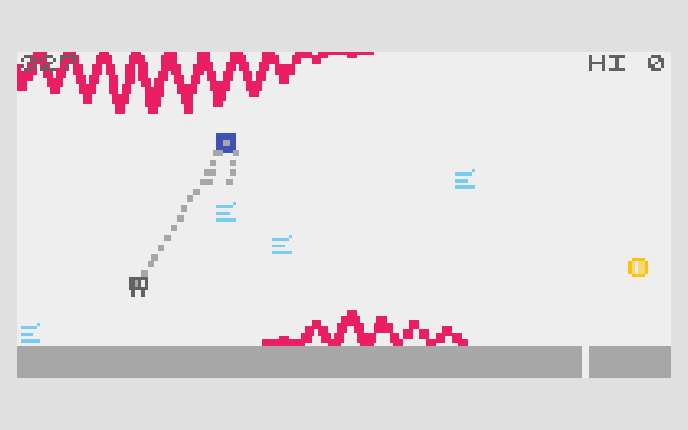

# Cloudhook Courier — visual pitch

Author: Codex manager. Authority: user-requested presentation of the delegated working design. Human review: pending. Updated: 2026-10-20, Asia/Shanghai.

## One more hook?

Sling a tiny courier between floating islands. Fold the kite to land and bank your seals, or keep sailing for a more valuable chain.

## References and borrowed parts

### CATAPULT

ABA Games / Kenta Cho. Borrowed: Skipping supports grows at-risk flight value; landing banks it.

### KITE

ABA Games / Kenta Cho. Borrowed: A tether separates the lifted sail from the vulnerable hanging actor.

[Full source claims and provenance](cloudhook-courier-references.html)

## Mutation

| Before | Our change |
| --- | --- |
| Rolling launch / global tilt | Direct sling aim + hold-to-sail flight |
| Separate launch and tether ideas | The courier must physically catch the bank hook |
| Endless scoring | Finite postal route; seals add optional reward |

**New decision:** Fold into the near hook and bank, or sail past it for a bigger chain?

One skipped rest hook raises each seal's bank value from 1 to 2. Carried seals also add weight.

### Fold and bank

Take the safe landing. Close the sail, settle the courier into the near hook, and secure the carried seals.

Skips this flight: 0; Value per seal: 1; Reward: Bank now.

### Sail past the hook

Carry the chain a little farther. Skip the rest hook for higher-value seals. Extra mass lowers lift; an open sail risks storm damage.

Skips this flight: 1; Value per seal: 2; Reward: Still at risk.

[Interactive rule diagram](cloudhook-courier.html#mutation)

## Game design

Aim: Compare folded / sail forecasts → Launch: Release the mooring sling → Sail: Pulse lift or fold to descend → Dock: Bank seals; stamp the next post.

Control: Pull to launch; hold to sail. Win: Stamp all 3 postal islands. Pressure: 75 seconds, storm, 2 seams.

## Why it could be fun

- **A voluntary dare.** The safe hook is visible, so passing it feels like your decision.
- **A small physical skill.** Control a sail while watching where the hanging courier will land.
- **A reason to retry.** A safe finish is valid; cleaner skips improve the same route.

These are design hypotheses, not validated enjoyment claims.

**Playtest question:** Do the two flight forecasts make a skip feel intentional?

[Open pitch](cloudhook-courier.html) · [Play game](https://games.arcaneforge.ai/game-library/cloudhook-courier/index.html) · [GDD](cloudhook-courier.html#design) · [All five](index.html)

Existing original Unity code/art. Source captures are local documentation evidence, not runtime assets. TikTok Minis is the intended destination; native packaging/device validation and human review remain pending. Audio is currently silent.
