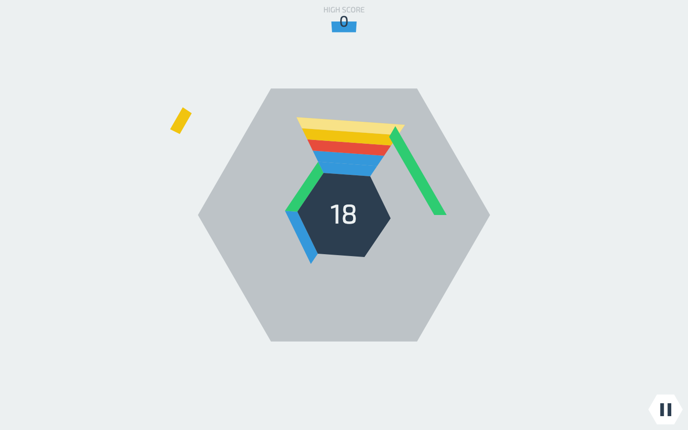
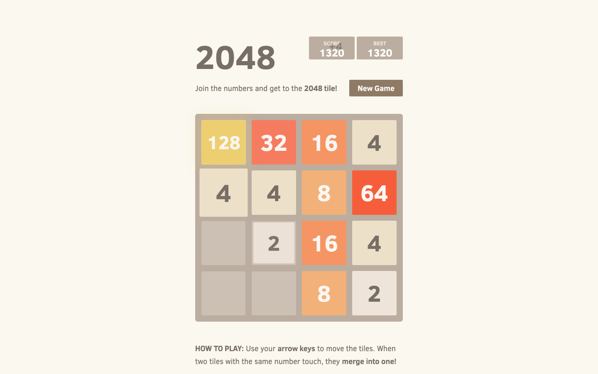

# Kiln Pop — design references

Published documentation by Arcane Forge. Updated: 2026-10-21, Asia/Shanghai.

Turn a pottery kiln to catch clay above and fire matching pieces below. Every rotation helps one station while changing the other.

## Hextris

Hextris contributors.

[Original primary source](https://github.com/Hextris/hextris)

Borrowed mechanism: Rotate one six-sided structure to route arrivals and manage space.

## 2048

Gabriele Cirulli.

[Original primary source](https://github.com/gabrielecirulli/2048)

Borrowed mechanism: Equal values compress into a higher rank, freeing room.

## What changed

| Reference operation | New game operation |
| --- | --- |
| Radial color clearing | Opposite catch and firing stations |
| Global slide merges | Only the firing pocket can fuse |
| Endless score / number target | Bowl → vase → vase deliveries |

These works are design references. Reference captures illustrate the compared mechanics; no reference game code, sprites or audio are included in the playable build. The Unity implementation and operational game art are original. Source-code licenses are not a claim of permission to reuse unrelated assets.

[Back to the visual pitch](kiln-pop.html) · [All five pitches](index.html)
