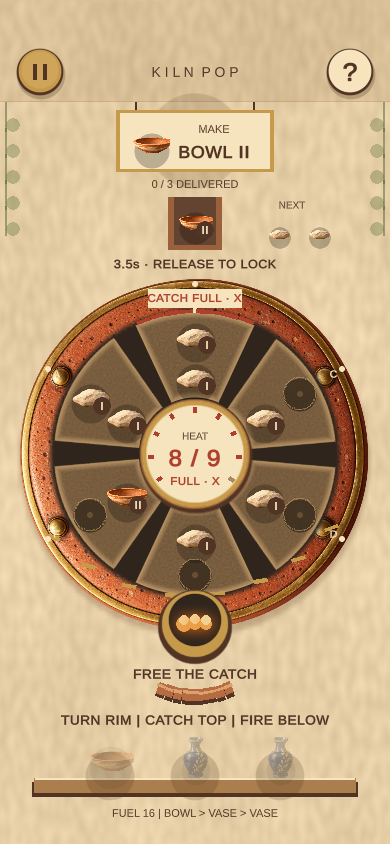
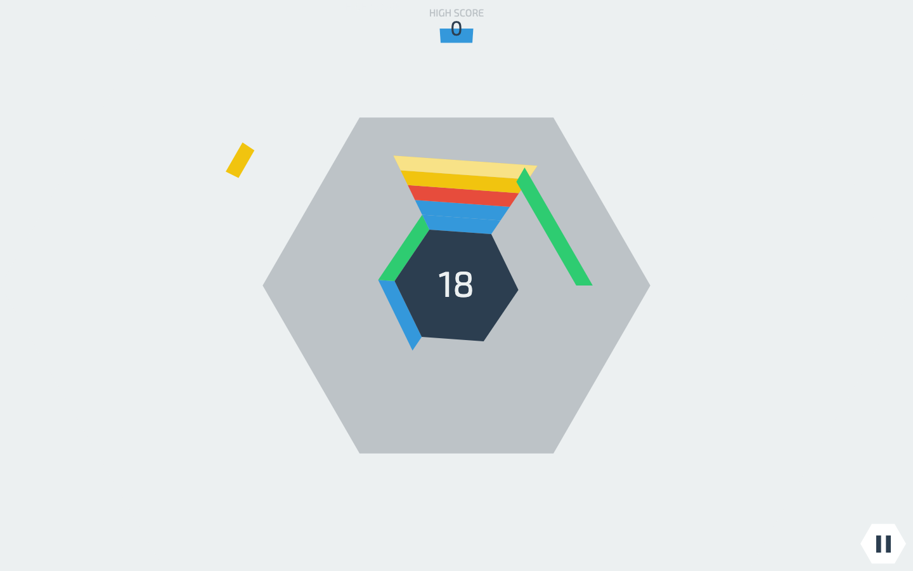
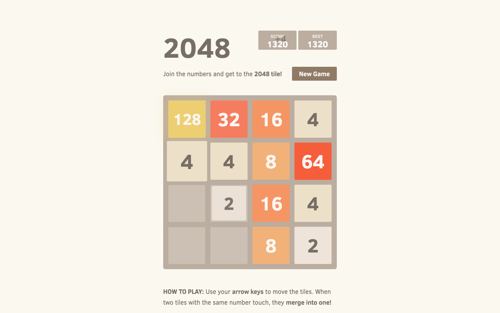

# Kiln Pop — visual pitch

Author: Codex manager. Authority: user-requested presentation of the delegated working design. Human review: pending. Updated: 2026-10-20, Asia/Shanghai.

## One turn. Two problems.

Turn a pottery kiln to catch clay above and fire matching pieces below. Every rotation helps one station while changing the other.

## References and borrowed parts

### Hextris

Hextris contributors. Borrowed: Rotate one six-sided structure to route arrivals and manage space.

### 2048

Gabriele Cirulli. Borrowed: Equal values compress into a higher rank, freeing room.

[Full source claims and provenance](kiln-pop-references.html)

## Mutation

| Before | Our change |
| --- | --- |
| Radial color clearing | Opposite catch and firing stations |
| Global slide merges | Only the firing pocket can fuse |
| Endless score / number target | Bowl → vase → vase deliveries |

**New decision:** Make room for the next clay, or fire the pair that cools the kiln?

Example: heat 6/9; order III; rank I arrives next. Both stations resolve on the same beat.

### Favor the next catch

A cleaner pair, a hotter kiln. Catch I beside I. The opposite pocket holds one bowl, so it cannot fuse.

Catch: I + I; Fire: Single II; Next heat: 7 / 9.

### Fire a pair now

Cool now; accept an awkward catch. Catch I beside II. The opposite I + I fires into a bowl and cools the kiln.

Catch: II + I; Fire: I + I → II; Next heat: 5 / 9.

[Interactive rule diagram](kiln-pop.html#mutation)

## Game design

Read: Next clay + active order → Turn: Preview both stations → Resolve: Catch → fuse → dispatch → Deliver: Cool down; build the next vase.

Control: Drag the kiln rim. Win: Deliver 3 pottery orders. Pressure: Heat, full pockets, 24 beats.

## Why it could be fun

- **A small planning knot.** The best catch and the best firing often disagree.
- **Visible transformation.** Two clay pieces become a bowl; bowls become a vase.
- **Recoverable mistakes.** Vent an unequal pair to reopen space, at a heat cost.

These are design hypotheses, not validated enjoyment claims.

**Playtest question:** Can you predict both ends of a turn without losing the rhythm?

[Open pitch](kiln-pop.html) · [Play game](https://games.arcaneforge.ai/game-library/kiln-pop/index.html) · [GDD](kiln-pop.html#design) · [All five](index.html)

Existing original Unity code/art. Source captures are local documentation evidence, not runtime assets. TikTok Minis is the intended destination; native packaging/device validation and human review remain pending. Audio is currently silent.
