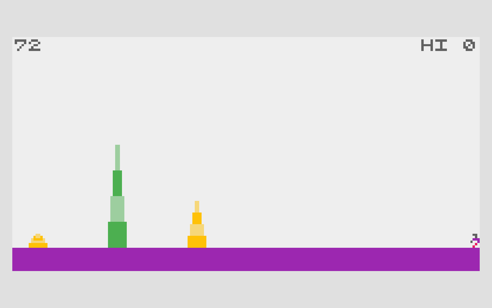
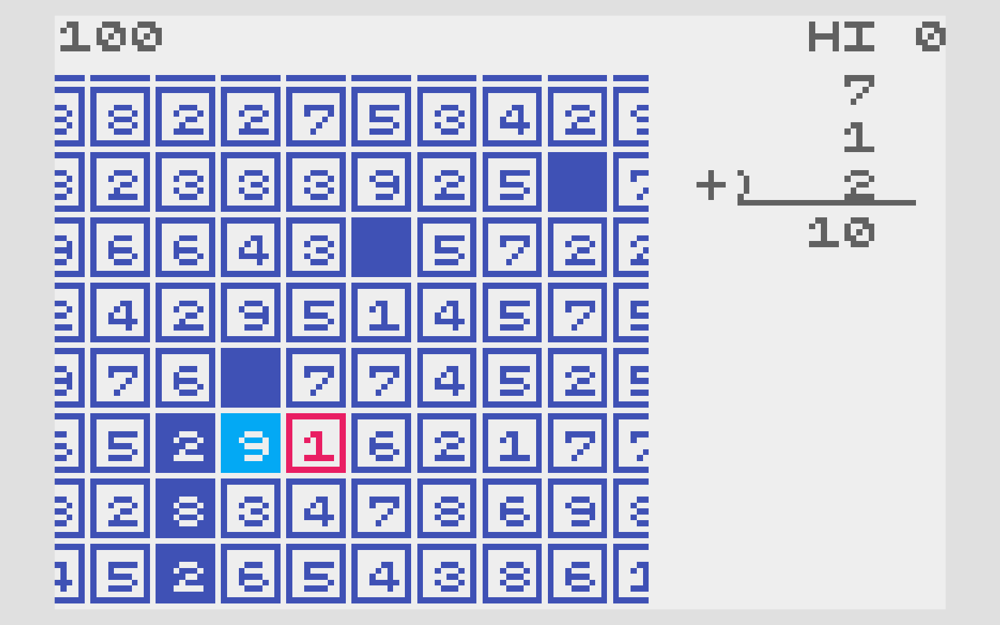

# Moonlit Harvest — design references

Published documentation by Arcane Forge. Updated: 2026-10-21, Asia/Shanghai.

Trace fruit into an exact-sum basket. The same cut protects those roots while the next moonlit column grows—and may wilt.

## BAMBOO

ABA Games / Kenta Cho.

[Original primary source](https://github.com/abagames/crisp-game-lib-games/blob/cfb39d2f988feb5918eb83697145b5a35adabf58/docs/bamboo/main.js)

Borrowed mechanism: Growth creates a harvest opportunity and an overgrowth threat.

## SUM TEN

ABA Games / Kenta Cho.

[Original primary source](https://github.com/abagames/crisp-game-lib-games/blob/cfb39d2f988feb5918eb83697145b5a35adabf58/docs/sumten/main.js)

Borrowed mechanism: A neighboring number route forms an arithmetic batch.

## What changed

| Reference operation | New game operation |
| --- | --- |
| Runner + real-time overgrowth | A still garden; growth after committed actions |
| Tap direction cycle / multiples of 10 | Reversible paths; exact targets 10 / 12 / 14 |
| Separate sum and survival pressures | Harvested roots escape the next growth tick |

These works are design references. Reference captures illustrate the compared mechanics; no reference game code, sprites or audio are included in the playable build. The Unity implementation and operational game art are original. Source-code licenses are not a claim of permission to reuse unrelated assets.

[Back to the visual pitch](moonlit-harvest.html) · [All five pitches](index.html)
