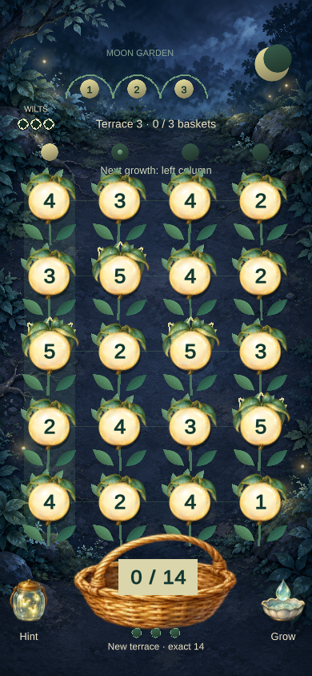
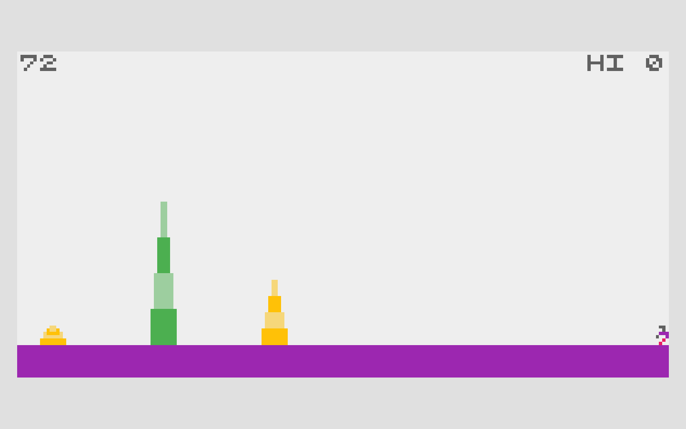
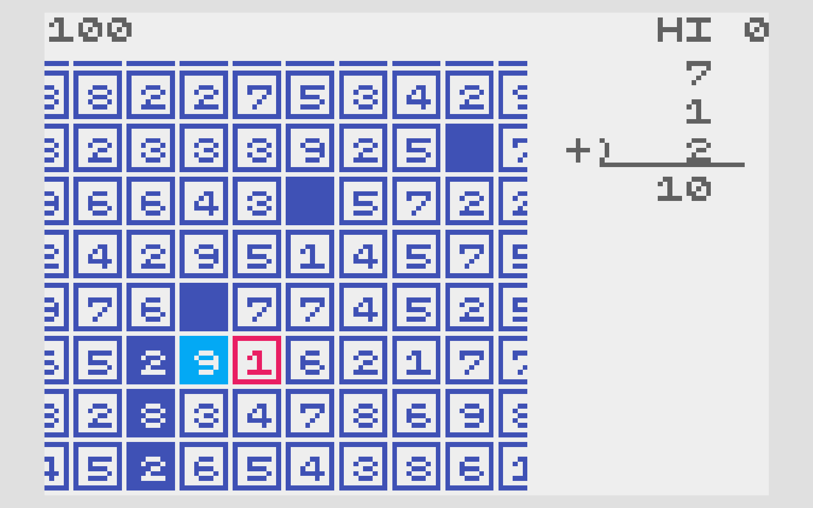

# Moonlit Harvest — visual pitch

Author: Codex manager. Authority: user-requested presentation of the delegated working design. Human review: pending. Updated: 2026-10-20, Asia/Shanghai.

## Same sum. Different tomorrow.

Trace fruit into an exact-sum basket. The same cut protects those roots while the next moonlit column grows—and may wilt.

## References and borrowed parts

### BAMBOO

ABA Games / Kenta Cho. Borrowed: Growth creates a harvest opportunity and an overgrowth threat.

### SUM TEN

ABA Games / Kenta Cho. Borrowed: A neighboring number route forms an arithmetic batch.

[Full source claims and provenance](moonlit-harvest-references.html)

## Mutation

| Before | Our change |
| --- | --- |
| Runner + real-time overgrowth | A still garden; growth after committed actions |
| Tap direction cycle / multiples of 10 | Reversible paths; exact targets 10 / 12 / 14 |
| Separate sum and survival pressures | Harvested roots escape the next growth tick |

**New decision:** Which exact-sum route also saves the plant about to wilt?

Example: target 10; the left column grows next. An uncut 5 wilts; harvested roots replant at 1 and skip that growth.

### Take 2 + 3 + 2 + 3

The basket is right; the garden pays. This connected route sums to 10 but leaves the leftmost ripe 5 uncut. It wilts on the growth tick.

Basket sum: 10; Ripe 5: Uncut; New wilts: 1.

### Take 5 + 2 + 3

Fill the basket and save the root. This other connected route also sums to 10. Harvest the ripe 5 before the same column grows.

Basket sum: 10; Ripe 5: Protected; New wilts: 0.

[Interactive rule diagram](moonlit-harvest.html#mutation)

## Game design

Read: Basket target + growth column → Trace: Backtrack freely; preview the sum → Harvest: Exact release commits the cut → Grow: Uncut column ripens; next basket.

Control: Trace 2–5 neighboring fruit. Win: Fill 9 baskets on 3 terraces. Pressure: 3 cumulative wilts; no timer.

## Why it could be fun

- **A second layer to a simple sum.** Two valid answers can leave very different gardens.
- **Time to think.** No real-time penalty; undo the route before committing.
- **A visible act of care.** Your solution fills a basket and keeps a vulnerable plant alive.

These are design hypotheses, not validated enjoyment claims.

**Playtest question:** Do you notice the growth forecast before your first avoidable wilt?

[Open pitch](moonlit-harvest.html) · [Play game](https://games.arcaneforge.ai/game-library/moonlit-harvest/index.html) · [GDD](moonlit-harvest.html#design) · [All five](index.html)

Existing original Unity code/art. Source captures are local documentation evidence, not runtime assets. TikTok Minis is the intended destination; native packaging/device validation and human review remain pending. Audio is currently silent.
