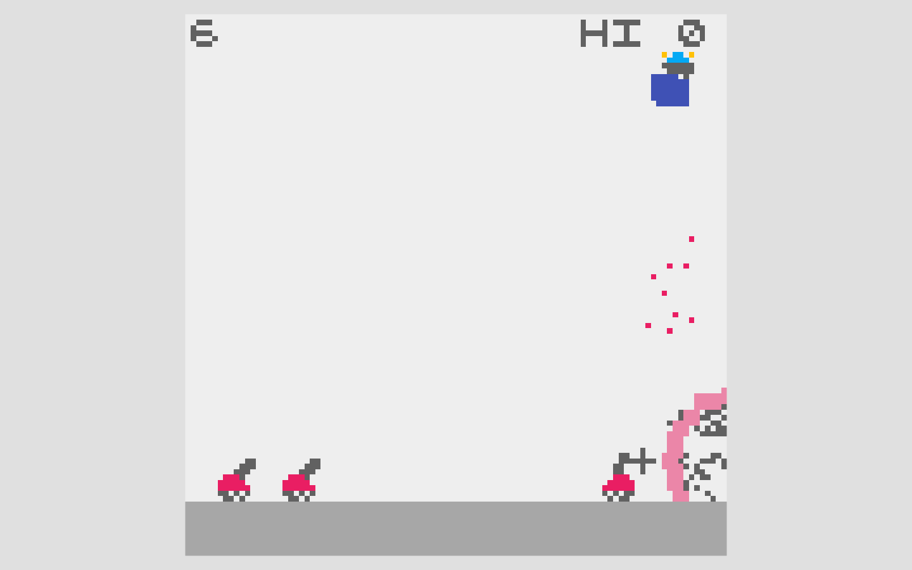
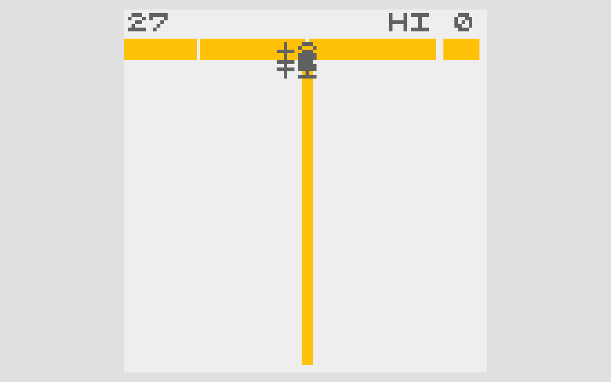

# Prism Reef — design references

Published documentation by Arcane Forge. Updated: 2026-10-21, Asia/Shanghai.

Aim a shell mirror to catch falling sparks. Charging narrows your defense but lets the return chain through matching coral—and heal the lantern.

## REFLECTOR

ABA Games / Kenta Cho.

[Original primary source](https://github.com/abagames/crisp-game-lib-games/blob/cfb39d2f988feb5918eb83697145b5a35adabf58/docs/reflector/main.js)

Borrowed mechanism: Holding strengthens a reflection while shrinking the interception span.

## COLOR ROLL

ABA Games / Kenta Cho.

[Original primary source](https://github.com/abagames/crisp-game-lib-games/blob/cfb39d2f988feb5918eb83697145b5a35adabf58/docs/colorroll/main.js)

Borrowed mechanism: The first struck color keys a beam; matching rows chain, mismatches stop it.

## What changed

| Reference operation | New game operation |
| --- | --- |
| Moving reflector / stronger blast | Fixed lantern; directly aimed charge capacity |
| Separate color-shot puzzle | The caught spark becomes the keyed coral ray |
| Short-chain penalty | Two-row chains restore a missing pearl |

These works are design references. Reference captures illustrate the compared mechanics; no reference game code, sprites or audio are included in the playable build. The Unity implementation and operational game art are original. Source-code licenses are not a claim of permission to reuse unrelated assets.

[Back to the visual pitch](prism-reef.html) · [All five pitches](index.html)
