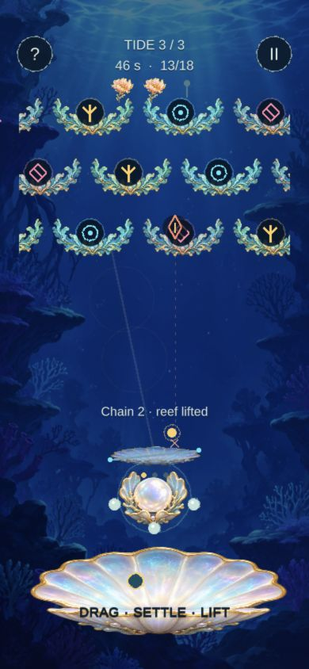
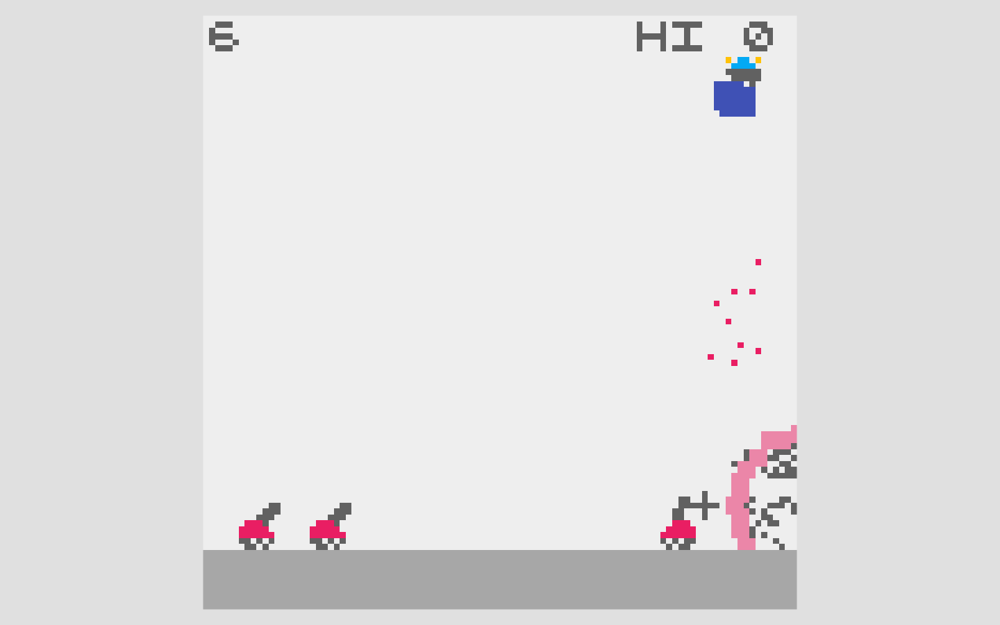
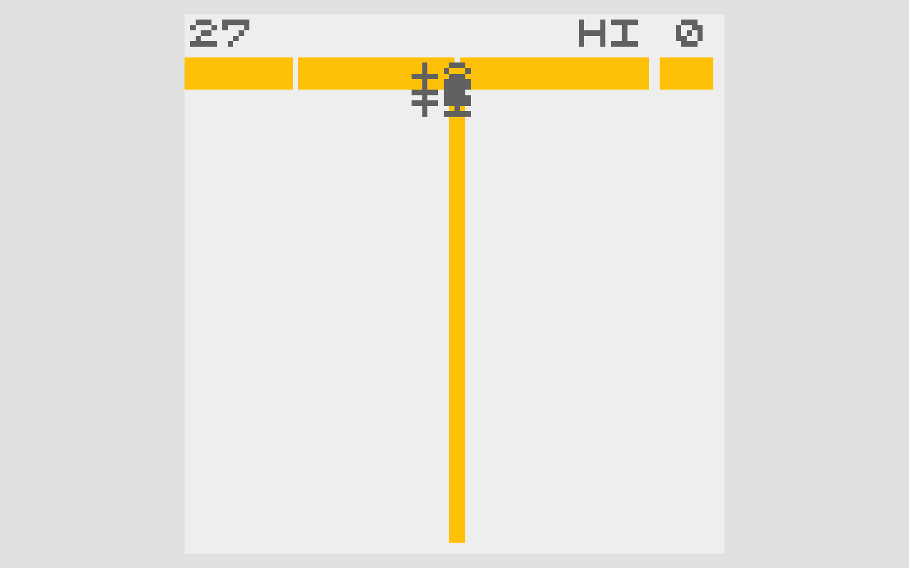

# Prism Reef — visual pitch

Author: Codex manager. Authority: user-requested presentation of the delegated working design. Human review: pending. Updated: 2026-10-20, Asia/Shanghai.

## A narrower shield. A brighter return.

Aim a shell mirror to catch falling sparks. Charging narrows your defense but lets the return chain through matching coral—and heal the lantern.

## References and borrowed parts

### REFLECTOR

ABA Games / Kenta Cho. Borrowed: Holding strengthens a reflection while shrinking the interception span.

### COLOR ROLL

ABA Games / Kenta Cho. Borrowed: The first struck color keys a beam; matching rows chain, mismatches stop it.

[Full source claims and provenance](prism-reef-references.html)

## Mutation

| Before | Our change |
| --- | --- |
| Moving reflector / stronger blast | Fixed lantern; directly aimed charge capacity |
| Separate color-shot puzzle | The caught spark becomes the keyed coral ray |
| Short-chain penalty | Two-row chains restore a missing pearl |

**New decision:** Keep a broad catch, or narrow the mirror for a healing chain?

Aim, catch width, and same-key alignment belong to one reflection. A mismatch still stops a fully charged ray.

### Use a broad catch

More room for an imperfect intercept. A relaxed mirror spans 112 pixels and clears one row. Good for an off-center spark.

Catch width: 112 px; Capacity: 1 row; Chain healing: None.

### Charge the return

Risk the catch for a recovery chain. At full charge the span is 44 pixels. Align matching keys to clear up to three rows; 2+ heals one pearl.

Catch width: 44 px; Capacity: 3 rows; Chain healing: +1 pearl.

[Interactive rule diagram](prism-reef.html#mutation)

## Game design

Read: Incoming spark + coral keys → Aim: Angle the shell from below → Charge: Trade catch width for capacity → Reflect: Clear, heal, and bloom onward.

Control: Drag to aim; settle to charge. Win: Clear 18 rows across 3 tides. Pressure: 3 pearls; a 75-second limit.

## Why it could be fun

- **Defense becomes offense.** A good intercept also solves the coral alignment.
- **Earned recovery.** A risky chain can repair earlier damage in the same move.
- **Readable mastery.** Watch the forecast, time the charge, then see the ray follow it.

These are design hypotheses, not validated enjoyment claims.

**Playtest question:** Does charging feel risky for a reason you can see?

[Open pitch](prism-reef.html) · [Play game](https://games.arcaneforge.ai/game-library/prism-reef/index.html) · [GDD](prism-reef.html#design) · [All five](index.html)

Existing original Unity code/art. Source captures are local documentation evidence, not runtime assets. TikTok Minis is the intended destination; native packaging/device validation and human review remain pending. Audio is currently silent.
